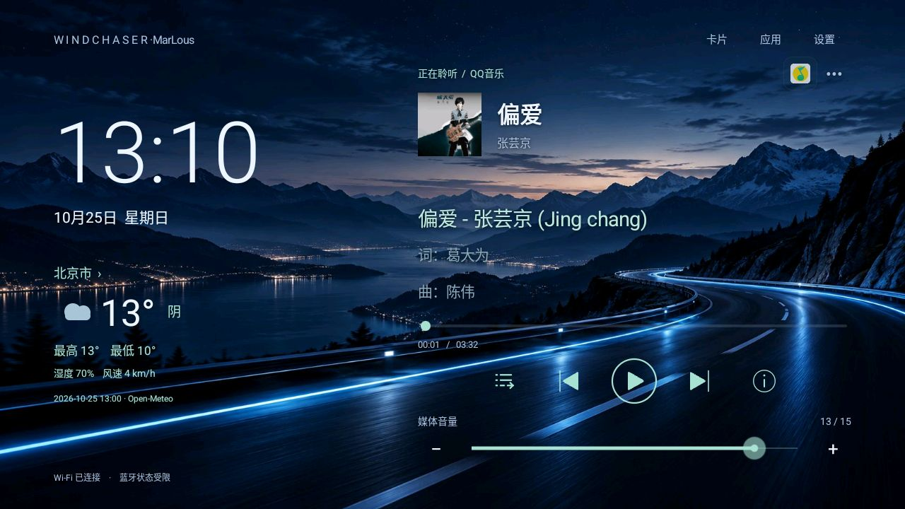
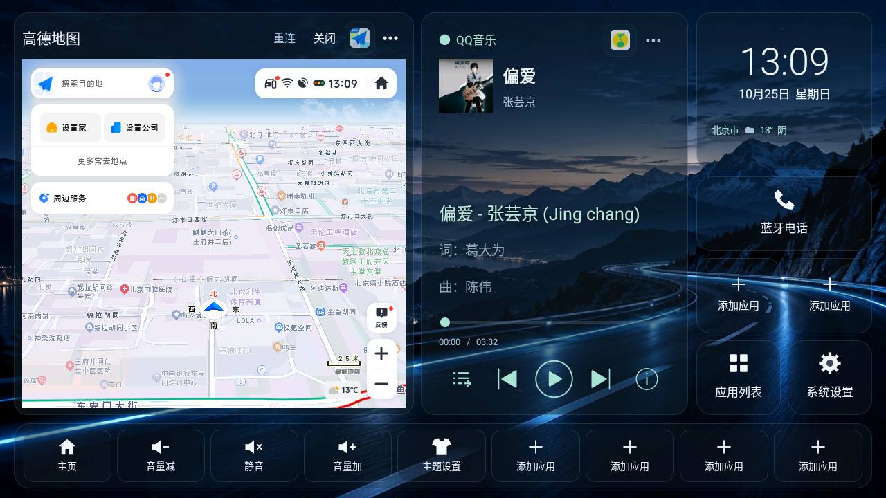
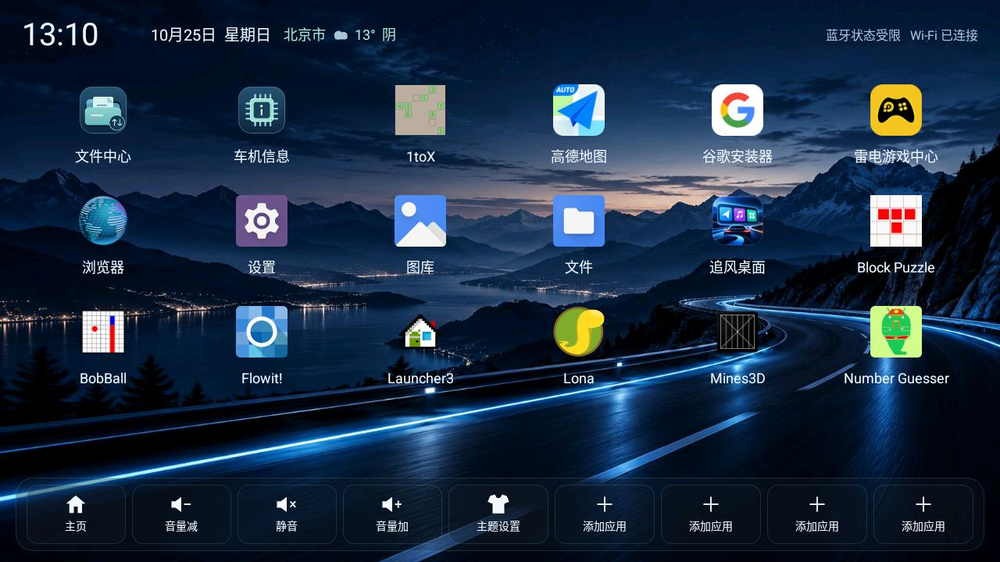

# WindChaser · 追风桌面

**安装前必读：** 当前为**第一版单 APK 整合版**，已内置配套的 **QQ音乐车机版 2.1.1.1** 和 **高德地图车机版 6.5.0.601323**。使用音乐控制、地图卡片等功能，**只需下载安装下方一个追风桌面整合版 APK**。

**追风桌面 WindChaser ·MarLous** 是面向横屏安卓车机的桌面应用，集成音乐控制、地图卡片、天气、应用管理、主题个性化与文件中心。

- [下载追风桌面第一版（整合版，仅需安装这一个 APK）](https://github.com/USNFJD/WindChaser/releases/download/v1.0.1/WindChaser-Unified-1.0.1-R1.apk)

**第一桌面 · 简洁主页**

**第二桌面 · 卡片主页**

**第三桌面 · 应用页面**

## 桌面与应用

- 简洁主页：时间、日期、天气与音乐播放界面，搭配图片或视频背景。
- 卡片主页：音乐、地图与快捷控件集中显示，便于日常操作。
- 应用页面：查看和打开已安装应用，应用较多时自动增加页面。
- 页面支持快速滑动切换与轻量过渡动画，末页可向前返回，不循环跳到首页。
- 长按应用图标可进入卸载操作，系统应用是否可卸载取决于车机权限。
- 快捷区提供时间日期、蓝牙电话、应用列表、系统设置和自定义应用入口，支持长按调整控件占用的行列。
- 布局随屏幕尺寸调整，适应不同大小的横屏显示区域。

## QQ音乐控制

- 显示歌曲名称、歌手、自动获取的歌曲封面及滚动歌词。
- 支持播放、暂停、上一曲、下一曲与播放模式切换。
- 当前歌词居中显示，支持拖动歌词或播放进度调整播放位置。
- 音量与系统媒体音量同步，可在桌面调节。
- 提供歌曲详情查看及进入 QQ音乐的入口。
- 支持独立悬浮音乐控制。

## 高德地图卡片

- 配合高德地图车机版 6.5，在桌面卡片内显示地图。
- 支持地图拖动、缩放与导航操作，也可进入地图完整界面。
- 地图卡片随桌面页面切换显示与隐藏。
- 保留地图原有的搜索、设置及导航功能。

音乐控制与地图卡片使用整合版内置的配套 QQ音乐和高德地图。

## 天气与地点

- 显示天气图标、温度和天气状况。
- 支持自动定位、手动设置地点及默认地点天气，默认城市为北京市。
- 可调整简洁主页的地点显示层级；卡片主页与应用页显示紧凑的城市、区县信息。
- 地点名称按层级分隔，长名称根据显示空间省略。

## 主题与个性化

- 支持默认背景、自选图片背景和视频背景。
- 可调整主题色、文字颜色、字号、卡片宽度、圆角、透明度及边框颜色等样式。
- 支持调整音乐、歌词和快捷控件的显示样式。
- 主题设置、文件中心和车机信息界面使用统一背景风格。

## 文件中心

- 文件管理与文件传输分别提供独立入口。
- 浏览系统允许访问的目录，支持打开、选择应用打开、复制、剪切、粘贴、删除、重命名和新建文件夹。
- 文件名显示后缀，重命名时可修改后缀；支持通过系统安装器打开 APK。
- 选择背景图片或视频时，可使用内置文件管理器，优先显示传输目录。
- 支持同一局域网或手机热点下，通过手机浏览器上传文件。
- 文件传输支持 HTTPS，默认端口 **8888**、默认访问码 **123456**，可自行修改。
- 一批最多 **200 个文件**，单文件最大 **300 MiB**，每个文件显示独立上传进度，支持失败重试。
- 支持追加文件、移除单项、清空队列、长文件名省略及重名文件自动编号。

## 车机信息

内置车机信息入口，可查看处理器、核心数量、最高频率、运行内存、安卓版本、设备型号等信息。

## 适用设备

适用于横屏安卓车机。桌面最低要求为 **Android 4.2**，重点适配 **Android 4.4.2**。不同车机的系统权限、硬件与配套应用支持情况可能影响部分功能。
